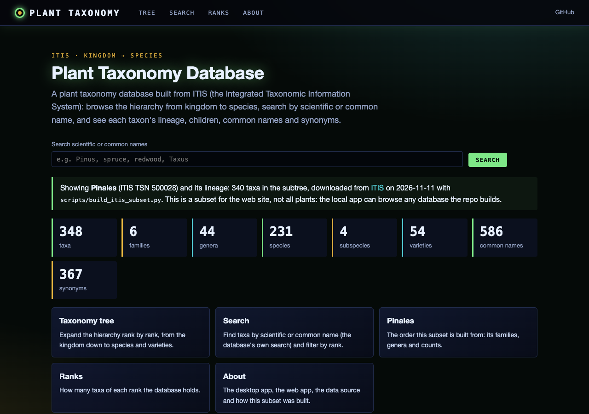
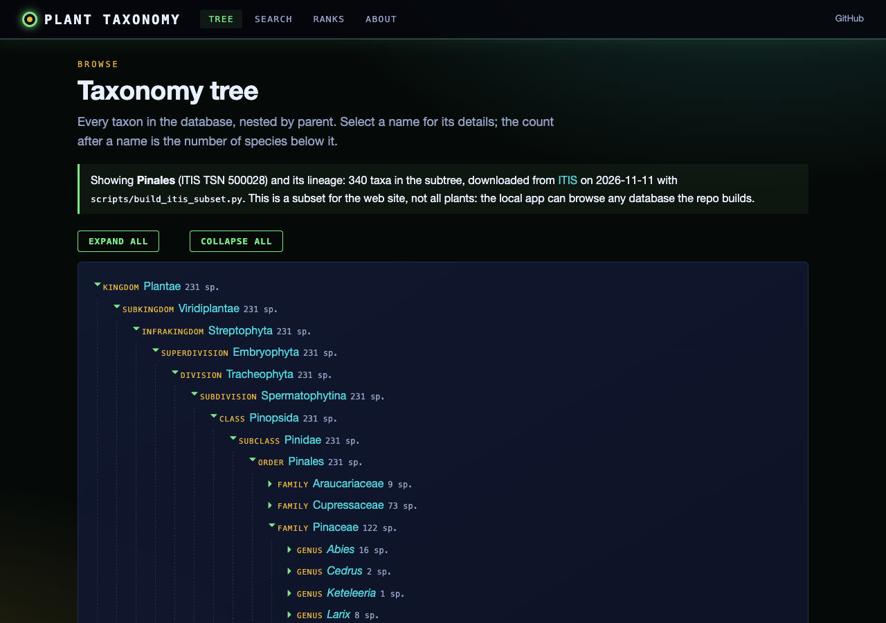
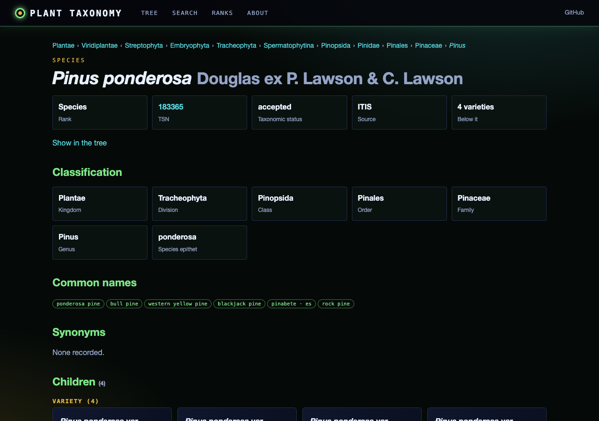
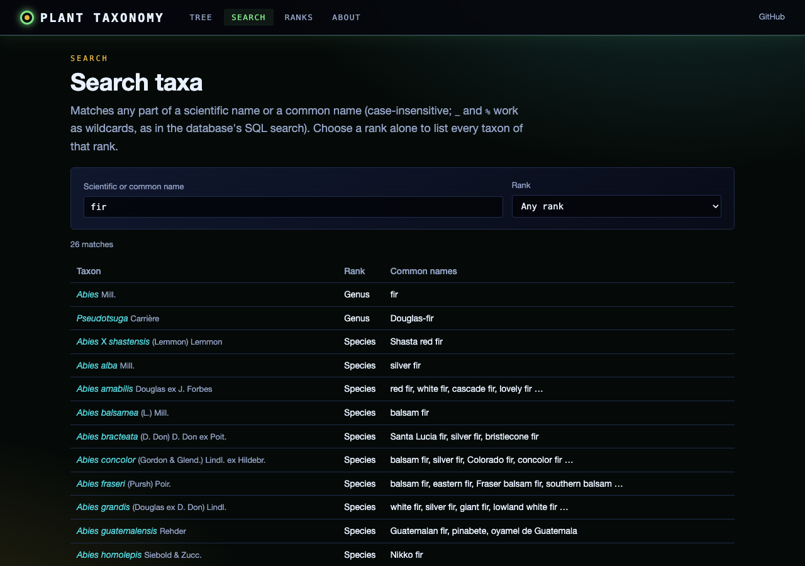

# Plant Taxonomy Database - Foundation

A modular Python application for building and querying a comprehensive plant taxonomy database with data from ITIS (Integrated Taxonomic Information System) and other sources.

## Project Structure

```
plant_taxonomy_db/
├── database/
│   ├── __init__.py
│   └── db_manager.py      # SQLite database management
├── api/
│   ├── __init__.py
│   └── itis_client.py     # ITIS web services client
├── models/
│   ├── __init__.py
│   └── taxonomy.py        # Data models for taxa
├── utils/
│   ├── __init__.py
│   └── formatting.py      # Display and formatting utilities
├── demo.py                # Demonstration and testing script
└── README.md              # This file
```

## Features

### Current Implementation

- **Database Management**
  - SQLite-based storage for taxonomic data
  - Hierarchical taxonomy structure (Kingdom → Species)
  - Support for common names and synonyms
  - Efficient indexing for fast searches

- **ITIS Integration**
  - Search by scientific name
  - Retrieve complete taxonomic hierarchies
  - Fetch common names
  - Download full records with metadata

- **Data Models**
  - Clean Python objects for taxa
  - Taxonomic hierarchy representation
  - Validation and conversion utilities

- **Search and Retrieval**
  - Search by scientific or common names
  - Retrieve complete lineage for any taxon
  - Get children of any taxon
  - Database statistics and summaries

## Installation

### Requirements

- Python 3.8+
- Internet connection (for ITIS API)

### Setup

```bash
# Install dependencies
pip install requests

# Make demo script executable (optional)
chmod +x demo.py
```

## Usage

### Quick Start - Run Demo

```bash
python demo.py
```

This will:
1. Create a demo database
2. Search ITIS for "Arabidopsis thaliana"
3. Download and store the complete taxonomic hierarchy
4. Demonstrate search and lineage display
5. Show database statistics

### Interactive Mode

```bash
python demo.py --interactive
```

Commands in interactive mode:
- `search <name>` - Search ITIS for a plant
- `add <tsn>` - Add a taxon by TSN to the database
- `find <name>` - Search the local database
- `lineage <tsn>` - Show taxonomic lineage for a TSN
- `stats` - Display database statistics
- `quit` - Exit

### Using as a Library

```python
from database.db_manager import TaxonomyDatabase
from api.itis_client import ITISClient
from models.taxonomy import Taxon

# Create database
db = TaxonomyDatabase("my_plants.db")
db.connect()
db.create_schema()

# Search ITIS
client = ITISClient()
results = client.search_by_scientific_name("Rosa")

# Get full record
tsn = int(results[0]['tsn'])
taxon = client.get_record(tsn)
lineage = client.get_full_hierarchy_from_tsn(tsn)

# Store in database
for taxon_item in lineage:
    db.insert_taxon(taxon_item.to_dict())

# Search local database
results = db.search_by_name("Rosa")

# Get lineage
lineage = db.get_lineage(tsn)

db.close()
```

## Web interface

A browser front end for the database: a taxonomy tree from kingdom to species and varieties, search by scientific or
common name with a rank filter, and a page per taxon with its lineage, classification, children, common names and
synonyms.

**Live site:** https://gddickinson.github.io/plant_taxonomy_db/ shows a subset built from ITIS with the repo's own
client: the conifer order **Pinales** (all its families, genera, species, subspecies and varieties, plus the lineage up
to Plantae), downloaded on 2026-11-11 (`data/pinales_itis.db`; see THIRD_PARTY.md). It is not the whole plant kingdom.

| Home | Tree | Taxon | Search |
|---|---|---|---|
|  |  |  |  |

### Run the web app

```bash
pip install -r requirements-web.txt
python run_web.py                              # http://127.0.0.1:8113 with the committed ITIS subset
python run_web.py --db plants_populated.db     # browse any database built by the GUI, demo.py or populate_database.py
```

The API (`/api/meta`, `/api/tree`, `/api/taxa`, `/api/taxon/<id>`, `/api/search?q=&rank=`) calls the repo's
`TaxonomyDatabase` queries (`get_lineage_by_id`, `get_children_by_taxon_data`, `search_by_name`, `get_statistics`) on a
read-only connection; it never contacts ITIS or GBIF.

- Rebuild the subset (needs internet): `python scripts/build_itis_subset.py [--name Pinales]`, then
  `python scripts/make_search_fixture.py`.
- Tests: `python -m pytest -q tests/test_web.py` (includes a check that the in-browser search gives the same results
  as the Python search).
- Static site: `python scripts/build_static.py` writes `site/`; `.github/workflows/pages.yml` publishes it on every
  push to `main` (Settings → Pages → Source: GitHub Actions).

## Database Schema

### Tables

**taxa**
- Stores taxonomic entities with hierarchical relationships
- Fields: tsn, kingdom, division, class, order, family, genus, species, rank, scientific_name, etc.
- Indexed on: scientific_name, parent_tsn, rank, kingdom

**common_names**
- One-to-many relationship with taxa
- Fields: tsn, common_name, language

**synonyms**
- Links synonym names to accepted taxa
- Fields: accepted_tsn, synonym_tsn, synonym_name

## Data Sources

### ITIS (Integrated Taxonomic Information System)
- Primary data source
- Well-documented API
- Comprehensive coverage of North American species
- URL: https://www.itis.gov

### Future Sources (Planned)
- USDA PLANTS Database
- World Flora Online
- GBIF (Global Biodiversity Information Facility)
- Tropicos (Missouri Botanical Garden)

## Examples

### Example 1: Build Database of Common Garden Plants

```python
from database.db_manager import TaxonomyDatabase
from api.itis_client import ITISClient

db = TaxonomyDatabase("garden_plants.db")
db.connect()
db.create_schema()

client = ITISClient()

# List of common garden plants
plants = [
    "Rosa rugosa",
    "Lavandula angustifolia",
    "Salvia officinalis",
    "Mentha spicata"
]

for plant_name in plants:
    results = client.search_by_scientific_name(plant_name)
    if results:
        tsn = int(results[0]['tsn'])
        lineage = client.get_full_hierarchy_from_tsn(tsn)
        for taxon in lineage:
            db.insert_taxon(taxon.to_dict())

stats = db.get_statistics()
print(f"Database contains {stats['total_taxa']} taxa")

db.close()
```

### Example 2: Explore a Plant Family

```python
from database.db_manager import TaxonomyDatabase
from utils.formatting import format_lineage
from models.taxonomy import Taxon

db = TaxonomyDatabase("my_plants.db")
db.connect()

# Search for roses (Rosaceae family)
results = db.search_by_name("Rosaceae")

for result in results:
    if result['rank'] == 'Family':
        # Get all genera in this family
        children = db.get_children(result['tsn'])
        print(f"\nGenera in {result['scientific_name']}:")
        for child in children:
            if child['rank'] == 'Genus':
                print(f"  - {child['scientific_name']}")

db.close()
```

## Development Roadmap

### Phase 1 (Current)
- ✅ Basic database structure
- ✅ ITIS integration
- ✅ Search and retrieval
- ✅ Lineage display

### Phase 2 (Next Steps)
- [ ] Batch download utilities
- [ ] Additional data source integrations (USDA, GBIF)
- [ ] Export to various formats (CSV, JSON)
- [ ] Simple CLI tool

### Phase 3 (Future)
- [ ] PyQt GUI for browsing
- [ ] Taxonomic tree visualization
- [ ] Geographic distribution data
- [ ] Image integration
- [ ] Genome database links

## Testing

Run the demo script to verify installation:

```bash
python demo.py
```

Expected output:
- Database creation confirmation
- ITIS search results
- Stored taxa count
- Lineage display
- Database statistics

## Contributing

This is a foundation for building a comprehensive plant taxonomy database. 
Suggested areas for contribution:
- Additional data source integrations
- Visualization tools
- Performance optimizations
- Additional metadata fields

## License

This project is for scientific and educational use.

## Acknowledgments

- ITIS (Integrated Taxonomic Information System) for taxonomic data
- USGS for maintaining the ITIS web services


---
*Built with AI assistance from [Claude (Anthropic)](https://claude.com/).*
